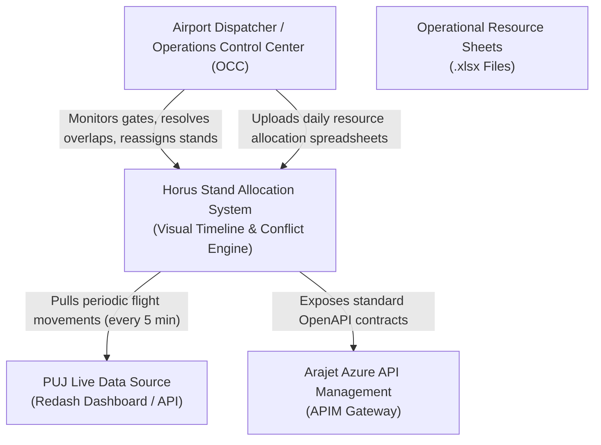
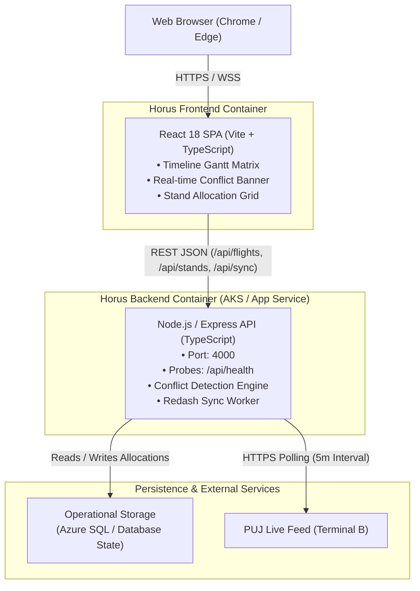
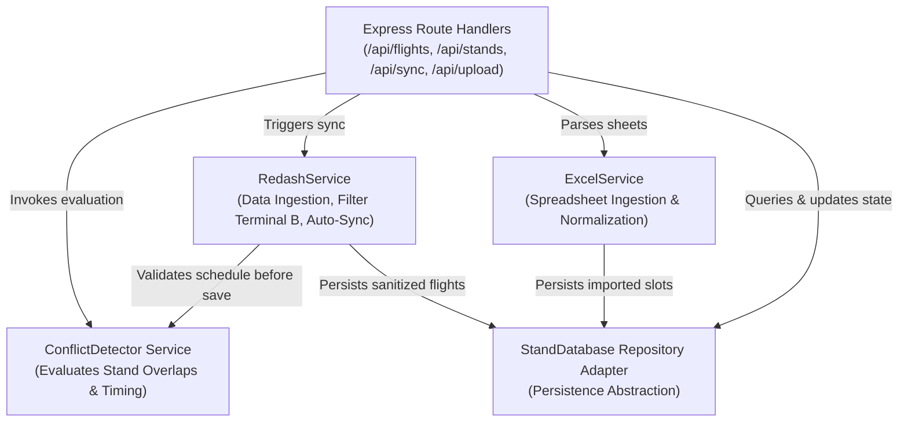

# Architecture Specification — C4 Model
## Application: Horus Flight Traffic Stand Allocation View
### Reference Standard: ARA-MAN-TIC-2008 (§3, pp. 21–22)

---

## 1. System Context Diagram (C4-1)
Describes how the Horus Stand Allocation application fits into the operational environment of Arajet and Punta Cana International Airport (PUJ).

---

## 2. Container Diagram (C4-2)
Describes the high-level technical building blocks, deployment units, and communication protocols.

---

## 3. Component Diagram (C4-3)
Decomposes the Backend Container into its internal modules and adapters.

